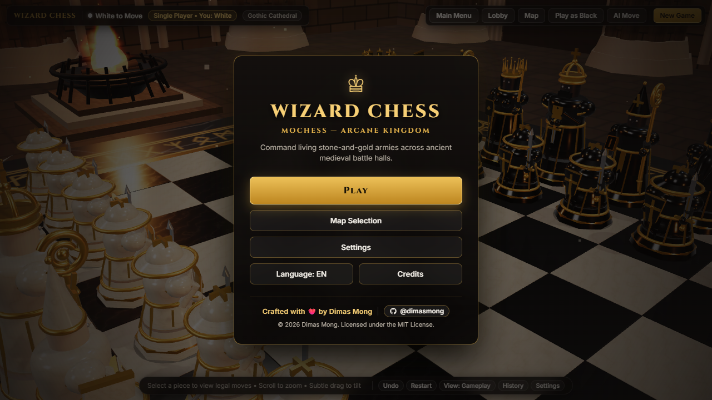
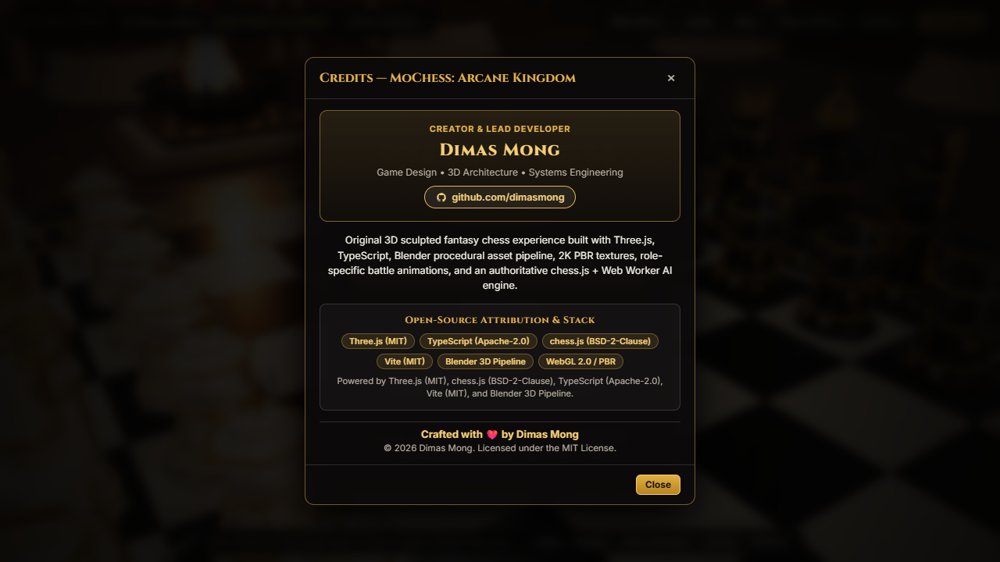
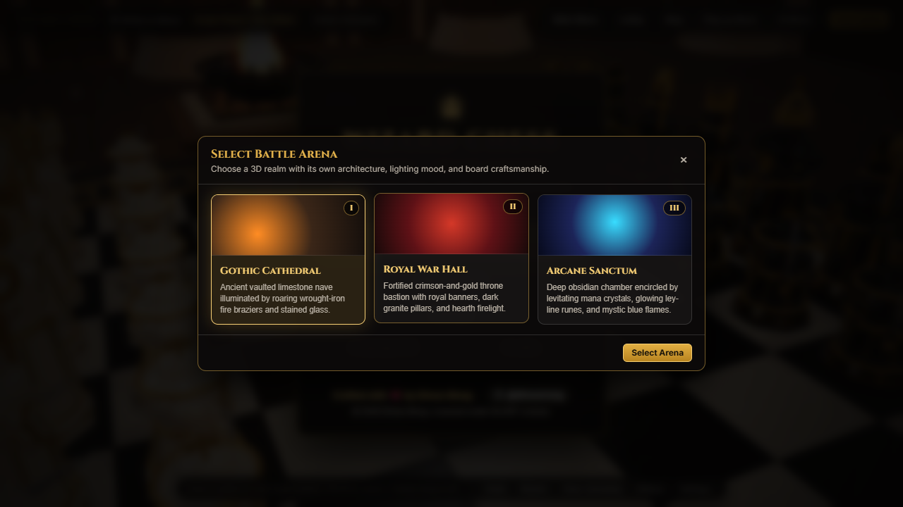
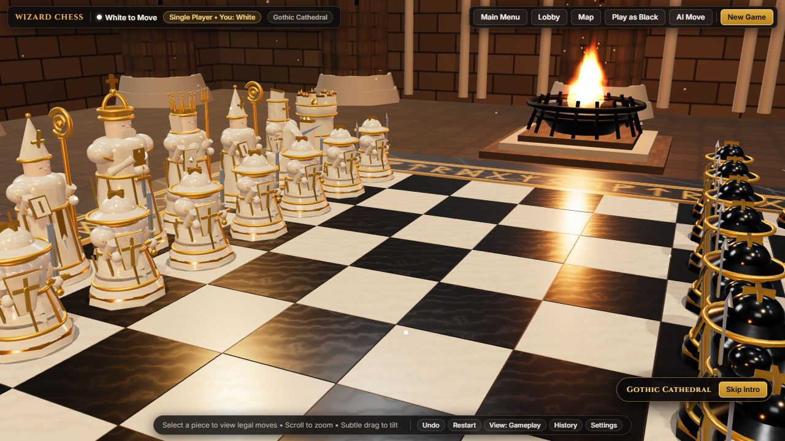
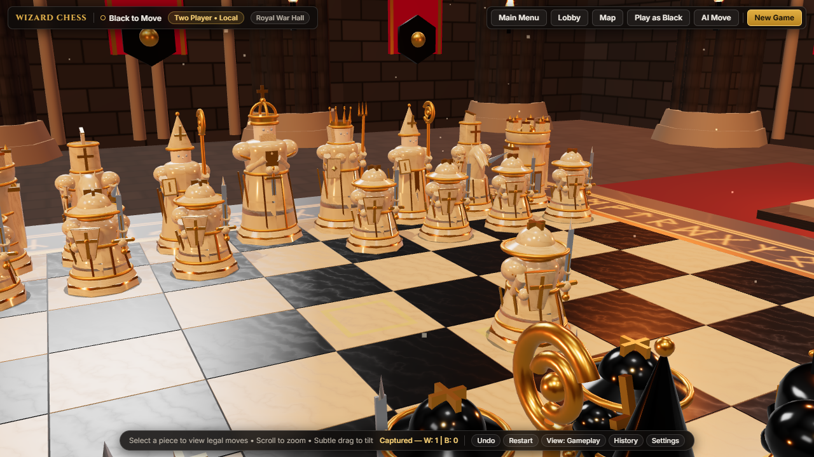
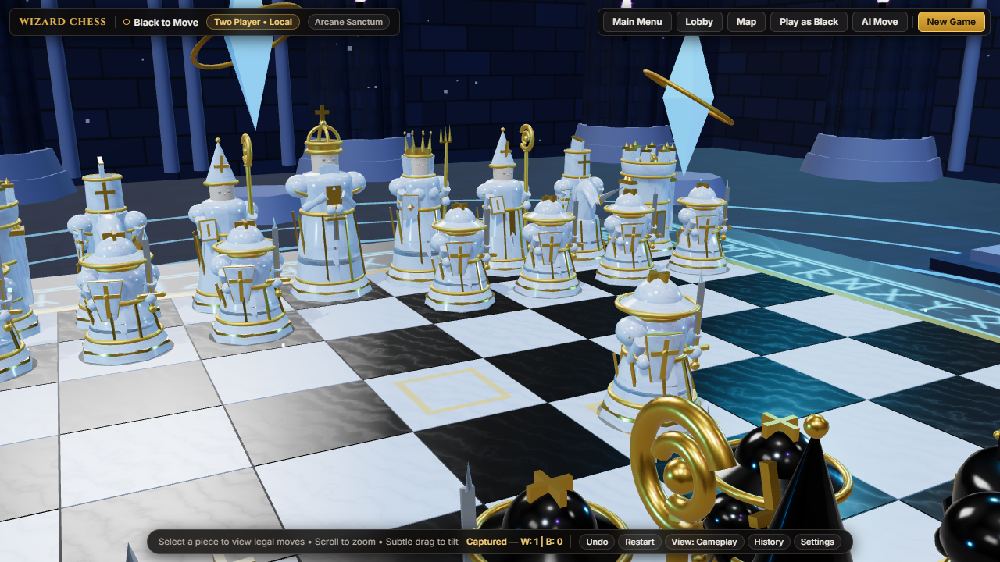
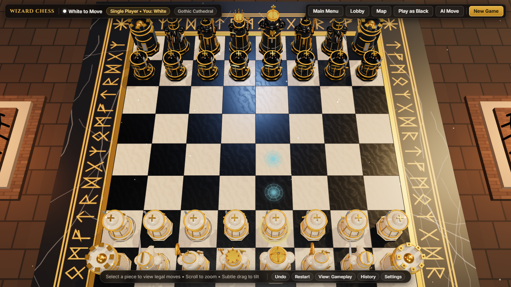
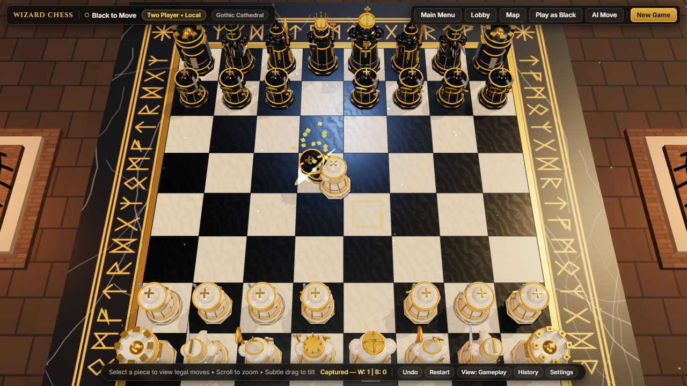
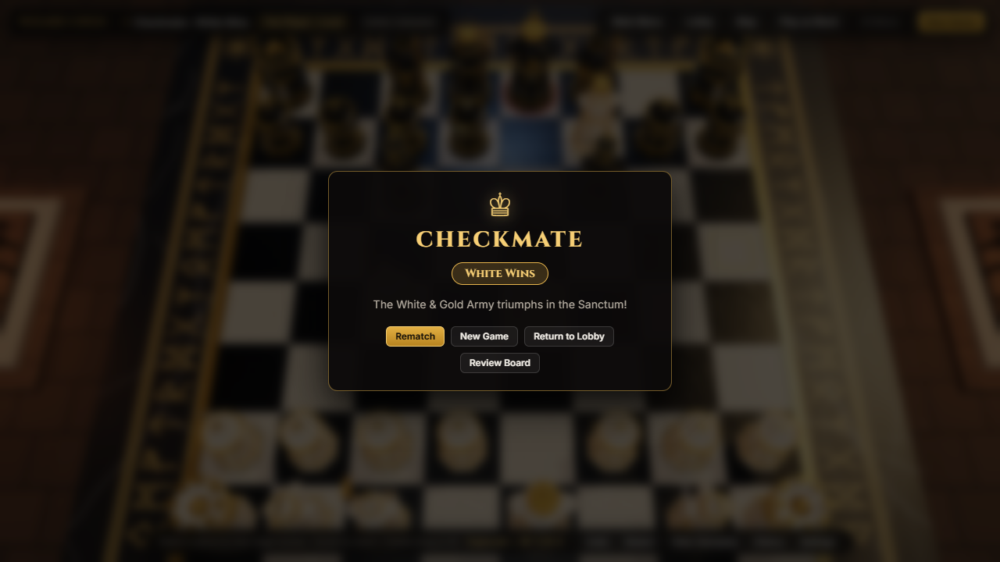
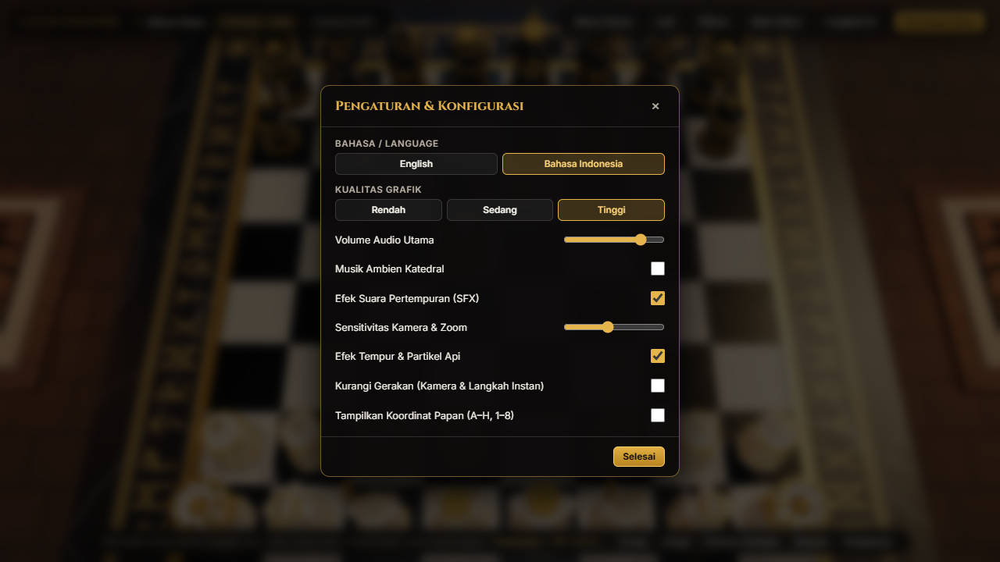

<div align="center">

# ♔ MoChess — Arcane Kingdom

**A Cinematic 3D Dark-Fantasy Wizard Chess Experience Built with Three.js, TypeScript & Blender**

[](./LICENSE)
[](https://www.typescriptlang.org/)
[](https://threejs.org/)
[](https://www.blender.org/)
[](https://github.com/dimasmong/MoChess/releases)
[](https://github.com/dimasmong/MoChess)

*Command living stone-and-gold armies across ancient medieval battle halls.*

[Playable Features](#-game-feature-overview) • [Screenshots](#-in-game-screenshots) • [Battle Arenas](#-battle-arenas--map-selection) • [Controls](#-gameplay-controls) • [Quick Start](#-installation--development) • [Releases](https://github.com/dimasmong/MoChess/releases)

</div>

---

## 📖 Overview

**MoChess — Arcane Kingdom** is an original, browser-playable 3D fantasy chess game inspired by classic cinematic wizard chess. Built with **Three.js**, **TypeScript**, **Vite**, an authoritative **chess.js** rules engine, a non-blocking **Web Worker AI**, and a headless **Blender / glTF 3D asset pipeline**, it pairs complete standard chess mechanics with sculpted medieval character pieces, role-specific battle animations, layered torchlight, and three distinct 3D fantasy arenas.

---

## ✨ Game Feature Overview

- **Sculpted 3D Fantasy Armies**: Original multi-material character sculptures (`body`, `gold`, `steel`, `face`) for all six chess piece roles (`Pawn`, `Knight`, `Bishop`, `Rook`, `Queen`, `King`) in contrasting **Ivory & Royal Gold** and **Obsidian & Imperial Gold** factions, exported to `.glb` (`public/models/arcane_pieces.glb`) with automatic two-tier Level of Detail (`LOD0` & `LOD1`).
- **Dual-Mode Camera System**:
  - **Mode 1 — Opening Cinematic Camera**: Orbital intro camera sweep across the roaring fire braziers, sculpted armies, and medieval architecture at match start (with a **Skip Intro** button).
  - **Mode 2 — Centered Strategic Gameplay Camera**: Comfortable high-angle/top-down chess view locked to the board center with strict zoom, tilt, and azimuth bounds—preventing disorienting free-orbit spin and eliminating wall or pillar clipping.
- **Role-Specific Locomotion & Battle Animations**:
  - Distinct movement cadence per piece role (infantry march, rearing warhorse leap, levitating prelate glide, fortress slide, regal stride).
  - Two-stage combat capture sequences where attackers advance to strike range, execute role-specific weapon or spell attacks, and shatter defeated pieces into glowing battle shards.
- **Complete Authoritative Chess Rules**: Powered by `chess.js`—supporting legal move & capture sigils, check indicators, kingside/queenside castling, en passant, pawn promotion (`Q`, `R`, `B`, `N`), checkmate, stalemate, threefold repetition, 50-move rule, insufficient material draws, move history, captured piece tracking, and optional blitz/rapid chess clocks.
- **Non-Blocking Web Worker AI**: Four selectable AI opponent ranks (`Novice`, `Knight`, `Archmage`, `Grandmaster`) powered by Alpha-Beta pruning, Quiescence search, MVV-LVA move ordering, and positional piece-square tables.
- **3 Distinct 3D Fantasy Maps**: Play across **Gothic Cathedral**, **Royal War Hall**, and **Arcane Sanctum**, each with bespoke 2K procedural PBR masonry, lighting, and board craftsmanship.
- **Bilingual UI (`EN` / `ID`)**: Instant live switching between **English** and **Bahasa Indonesia** across the Main Menu, Lobby, HUD, Settings, Credits, and Checkmate screens.
- **Synthesized Dark-Fantasy Audio**: Zero-dependency Web Audio API soundscape featuring ambient D-minor cathedral drone pads, Dorian harp chimes, stone footsteps, and role-specific battle clash SFX.

---

## 📸 In-Game Screenshots

All screenshots below are genuine captures taken directly from the running WebGL build:

### Main Menu & Developer Credits
| Main Menu (`01_main_menu.png`) | Developer Credits (`02_credits_modal.png`) |
| :---: | :---: |
|  |  |

### Map Selection & Opening Cinematic
| Select Battle Arena (`03_map_selection.png`) | Opening Cinematic Camera (`04_map_gothic_cathedral.png`) |
| :---: | :---: |
|  |  |

### Battle Arenas (`Royal War Hall` & `Arcane Sanctum`)
| Royal War Hall (`05_map_royal_war_hall.png`) | Arcane Sanctum (`06_map_arcane_sanctum.png`) |
| :---: | :---: |
|  |  |

### Strategic Gameplay & Role-Specific Battle Animations
| Centered Strategic Gameplay (`07_gameplay_strategic.png`) | Mid-Capture Sword Slash & Shatter (`08_battle_capture_animation.png`) |
| :---: | :---: |
|  |  |

### Checkmate Overlay & Bilingual Settings (`EN` / `ID`)
| Checkmate Result Screen (`09_checkmate_screen.png`) | Settings in Bahasa Indonesia (`10_settings_indonesian.png`) |
| :---: | :---: |
|  |  |

---

## 🏰 Battle Arenas & Map Selection

1. **Gothic Cathedral (`cathedral`)**  
   Weathered dark limestone ashlar masonry, clustered fluted Gothic columns, blind arcades, stained-glass lancet windows, roaring wrought-iron fire braziers, and a satin-matte obsidian & ivory chessboard framed by golden Elder-Futhark runes.
2. **Royal War Hall (`warhall`)**  
   Fortified iron-granite bastion draped in crimson-and-gold royal heraldic banners, mounted war shields, a crimson war-carpet runner, warm hearth firelight, and a champagne-travertine & burnished-bronze war-table board.
3. **Arcane Sanctum (`sanctum`)**  
   Deep astral-indigo obsidian chamber encircled by 8 levitating mana crystal monoliths with orbiting golden astrolabe rings, luminous floor ley-line rings, mystic cyan-violet arcane flames, and a moonlight-alabaster & void-obsidian board.

---

## ⚔️ Character Movement & Battle Animations

| Piece | Sculpted Archetype | Locomotion Style | Role-Specific Capture / Attack |
| :--- | :--- | :--- | :--- |
| **Pawn (`p`)** | Royal Vanguard Footman | Brisk infantry march with shield poise | Diagonal broadsword lunge & glowing golden slash crescent |
| **Knight (`n`)** | Armored Destrier Warhorse | Rearing takeoff & high vaulting jump | Hind-leg warhorse rear & couched lance thrust shockwave |
| **Bishop (`b`)** | Cathedral Prelate Mage | Serene levitating arcane glide | Raised spiraled crosier & vertical arcane spell beam + rune sigil |
| **Rook (`r`)** | Citadel Battlement Keep | Heavy fortress slide with momentum | Rising siege tower slam & double seismic shockwave rings |
| **Queen (`q`)** | Crowned High Sovereign | Regal levitating glide | Celestial scepter sky-pillar beam & radiant star-nova burst |
| **King (`k`)** | Imperial High Monarch | Deliberate commanding stride | Two-handed overhead royal greatsword cleave & golden shockwave |

---

## 🎮 Gameplay Controls & Modes

### Controls (Desktop & Android Mobile)
| Action | Desktop (Mouse) | Android / Mobile (Touch) |
| :--- | :--- | :--- |
| **Select Piece / Move** | Left-click friendly piece, then click legal sigil square | Tap friendly piece, then tap legal sigil square |
| **Zoom In / Out** | Mouse scroll wheel (`[6.8..14.2]` safe bounds) | Two-finger pinch gesture |
| **Subtle Angle Adjustment** | Left-click + drag (restricted within safe chess bounds) | Single-finger swipe |
| **Switch Camera Preset** | Click `View: Gameplay / Overhead / 3/4` in bottom bar | Tap `View` button in bottom bar |
| **Skip Intro Cinematic** | Click `Skip Intro` or click anywhere on the board | Tap `Skip Intro` or tap the board |

> **Accidental Input Protection**: Any pointer drag exceeding `6px` or multi-touch gesture is classified as a camera adjustment and will never accidentally select or move a chess piece.

### Available Game Modes
- **Single Player (Player vs AI)**: Choose **White & Gold** or **Black & Gold** against 4 AI difficulty ranks (`Novice`, `Knight`, `Archmage`, `Grandmaster`).
- **Two Player (Local Pass & Play)**: Play Human vs Human on the same device.
- **Time Controls**: `Unlimited`, `3m Blitz`, `5m Blitz`, or `10m Rapid`.

---

## 🌐 English & Indonesian Language Support

MoChess includes complete built-in localization (`src/ui/i18n.ts`) for:
- **English (`en`)**
- **Bahasa Indonesia (`id`)**

Players can toggle the language at any time from the **Main Menu (`Language: EN / ID`)** or inside **Settings (`Language / Bahasa`)**, immediately updating all menus, HUD indicators, map descriptions, promotion titles, and endgame banners.

---

## 🛠️ Technology Stack

- **3D Rendering**: [Three.js](https://threejs.org/) (`WebGLRenderer`, `ACESFilmicToneMapping`, `PCFSoftShadowMap`, `PMREMGenerator`, `GLTFLoader`, `AnimationMixer`, `LOD`)
- **Language & Build Tooling**: [TypeScript 5.6](https://www.typescriptlang.org/) + [Vite 5](https://vitejs.dev/)
- **Authoritative Chess Engine**: [chess.js](https://github.com/jhlywa/chess.js) (`v1.0.0-beta.8`)
- **AI Opponent**: Custom Web Worker (`src/ai/chessAI.worker.ts`) using Negamax + Alpha-Beta pruning + Quiescence search + MVV-LVA
- **3D Asset Pipeline**: Headless Blender Python generator (`scripts/blender/generate_pieces.py`) + Node.js `GLTFExporter` pipeline (`scripts/generate_glb_assets.mjs`) outputting `public/models/arcane_pieces.glb`
- **Automated Testing & QA**: [Vitest](https://vitest.dev/) + [Playwright](https://playwright.dev/) headless WebGL verification

---

## 🚀 Installation & Development

### Prerequisites
- **Node.js** `>= 18.0.0` and **npm** `>= 9.0.0`
- *(Optional)* **Blender** `>= 3.6` if running the standalone headless `.blend` Python script

### 1. Clone & Install Dependencies
```bash
git clone https://github.com/dimasmong/MoChess.git
cd MoChess
npm install
```

### 2. Run Local Development Server
```bash
npm run dev
```
Open `http://localhost:5173` in any modern desktop or mobile browser.

### 3. Run Automated Unit & Asset Tests
```bash
npm test
```

### 4. Generate 3D GLB Models & Build for Production
```bash
npm run build
npm run preview
```
The production build outputs a static bundle to `dist/` ready for deployment on GitHub Pages, Vercel, Netlify, or any static web server.

---

## 📂 Project Structure

```text
MoChess/
├── docs/
│   └── screenshots/              # Verified in-game WebGL screenshots
├── public/
│   └── models/                   # Exported 3D glTF/GLB piece assets (arcane_pieces.glb)
├── scripts/
│   ├── blender/
│   │   └── generate_pieces.py    # Headless Blender Python 3D asset & rig generator
│   ├── generate_glb_assets.mjs   # Automated GLB build & validation script
│   └── verify_and_screenshot.mjs # Playwright E2E WebGL verification & screenshot runner
├── src/
│   ├── ai/
│   │   ├── AIManager.ts          # Non-blocking Web Worker AI coordinator
│   │   └── chessAI.worker.ts     # Alpha-Beta + Quiescence search worker
│   ├── assets/
│   │   ├── PieceAssetManager.ts  # GLB loader, LOD assembly, AnimationMixer & PBR materials
│   │   ├── PieceGeometryBuilder.ts # Sculpted medieval piece geometry builder
│   │   └── ProceduralTextures.ts # 2K procedural marble, masonry, rune & flame sprite textures
│   ├── audio/
│   │   └── SoundManager.ts       # Web Audio API dark-fantasy music & role-specific SFX
│   ├── engine/
│   │   ├── ChessGameEngine.ts    # Authoritative chess.js state machine & persistence
│   │   └── types.ts              # Shared TypeScript interfaces
│   ├── scene/
│   │   ├── AnimationController.ts # Locomotion, role-specific combat & shatter FX
│   │   ├── CastleArenaBuilder.ts # 3D environments (Cathedral, War Hall, Sanctum) & fire braziers
│   │   ├── ChessboardBuilder.ts  # Satin-matte chessboard, rune frame & legal move sigils
│   │   └── SceneManager.ts       # Three.js renderer, dual camera modes & raycasting
│   ├── styles/
│   │   └── main.css              # Responsive dark-fantasy glassmorphic UI styles
│   ├── ui/
│   │   ├── i18n.ts               # Bilingual English (EN) & Indonesian (ID) dictionary
│   │   └── UIManager.ts          # Main Menu, Map Selection, Lobby, HUD & Settings controller
│   └── main.ts                   # Application bootstrap
├── tests/
│   ├── ai.test.ts                # AI legality & tactical capture tests
│   ├── assets.test.ts            # 3D geometry & GLB export/import verification tests
│   └── engine.test.ts            # Full chess rules, castling, en passant, promotion & i18n tests
├── index.html
├── LICENSE
├── package.json
├── tsconfig.json
└── vite.config.ts
```

---

## 📜 Credits & Open-Source Attribution

- **Creator & Lead Developer**: **Dimas Mong** — [https://github.com/dimasmong](https://github.com/dimasmong)
- **Open-Source Libraries**:
  - [Three.js](https://threejs.org/) — MIT License
  - [chess.js](https://github.com/jhlywa/chess.js) — BSD-2-Clause License
  - [TypeScript](https://www.typescriptlang.org/) — Apache-2.0 License
  - [Vite](https://vitejs.dev/) — MIT License
  - [Blender](https://www.blender.org/) — GPL-3.0 License (3D asset creation workflow)

---

## ⚖️ License

This project is licensed under the **MIT License** — see the [LICENSE](./LICENSE) file for details.

<div align="center">

**Crafted with ❤️ by [Dimas Mong](https://github.com/dimasmong)**  
*© 2026 Dimas Mong. Licensed under the MIT License.*

</div>
