<div align="center">

# ♔ MoChess
### Wizard Chess — Arcane Kingdom

**A Cinematic 3D Dark-Fantasy Chess Game Featuring Magical Battles, Sculpted Armies, Multiple Arenas, Customizable Skins, AI Opponents & Online PvP**

[](https://mochess-arcane.vercel.app)
[](https://github.com/dimasmong/MoChess/releases)

[](https://www.typescriptlang.org/)
[](https://threejs.org/)
[](./scripts/blender/generate_pieces.py)
[](./tests)
[](./LICENSE)

**[▶ Play Live in Browser](https://mochess-arcane.vercel.app)** • **[⬇ Download Latest Release](https://github.com/dimasmong/MoChess/releases)** • **[📸 Screenshots](#-screenshots)** • **[⚔️ Features](#-features)** • **[🛠️ Local Setup](#-installation--local-development)**

</div>

---

## 📖 About the Game

**MoChess: Wizard Chess - Arcane Kingdom** is an original, browser-playable 3D dark-fantasy chess game that unites complete, authoritative FIDE chess rules with cinematic medieval-arcane presentation.

Command sculpted ivory, obsidian, warforged iron, astral crystal, or championship Staunton armies across atmospheric 3D battle halls. Every move comes alive with role-specific locomotion, weapon and spell capture animations, shattering battle shards, original magical orchestral-choir compositions, and dramatic King-vs-King checkmate finisher cutscenes—playable seamlessly on both **Desktop** and **Android mobile** browsers with zero installation required.

---

## ✨ Features

- **Real 3D Fantasy Chess Gameplay**: Full 64-square WebGL battlefields rendered with Three.js (`ACESFilmicToneMapping`, PBR materials, dynamic torchlight, and dual-tier `LOD0`/`LOD1` piece meshes) backed by an authoritative `chess.js` rules engine supporting castling, en passant, pawn promotion (`Q`, `R`, `B`, `N`), check, checkmate, stalemate, threefold repetition, 50-move rule, and insufficient material draws.
- **Dedicated Animated 3D Main Menu Scene**: Standalone dark-fantasy presentation stage featuring a towering Sovereign King pedestal, orbiting golden rune ribbons, roaring fire braziers, drifting embers, and subtle camera motion—completely separate from the active match board.
- **24 Sculpted 3D Piece Models Across 4 Skins**: Distinct multi-material 3D character sets (`Arcane Royalty`, `Runic Warforged`, `Mystic Sanctum`, and `Classic Staunton`) exported to binary glTF 2.0 (`public/models/*.glb`).
- **3-Layer Top-Down Piece Recognition System**: Designed specifically for strategic high-angle and `90°` overhead play—combining unique upper 3D silhouettes, extruded 3D top role emblems (`✠`, `✴`, `◆`, `♞`, `♜`, `●`), and controlled gemstone/enamel accent colors, plus an optional **Piece Identification Markers (`ON / OFF`)** setting.
- **Role-Specific Attack & Capture Animations**: Two-stage combat choreography where attackers advance into strike range, unleash role-unique melee or arcane spell attacks, and shatter captured enemies into glowing fragments.
- **Cinematic Checkmate Finishers**: Dedicated post-checkmate King-vs-King execution cutscene before transitioning cleanly into the Victory / Result screen.
- **Single Player vs AI (`4` Difficulty Ranks)**: Non-blocking Web Worker AI opponent (`Novice`, `Knight`, `Archmage`, `Grandmaster`) powered by Negamax + Alpha-Beta pruning, Quiescence search, MVV-LVA move ordering, and positional piece-square tables.
- **Local Multiplayer (`Pass & Play`)**: Instant two-player matches on a single desktop or mobile device.
- **Online Private PvP (`1v1 Room Multiplayer`)**: Create private battle rooms with 6-character codes and shareable invite links (`?room=XXXXXX`), backed by server-authoritative `chess.js` move validation, private seat tokens, reconnect recovery, and rematch handshakes.
- **Optional Chess Clocks**: Play untimed (`Unlimited`) or timed matches (`3m Blitz`, `5m Blitz`, `10m Rapid`).
- **4 Distinct 3D Battle Arenas**: Play inside **Gothic Cathedral**, **Royal War Hall**, **Arcane Sanctum**, or **Classic Board**, complete with real 3D WebGL selection previews.
- **Original Magical Fantasy Soundtrack**: Five seamless-looping multi-instrument fantasy scores (Main Menu + 4 arena themes) paired with synthesized battle SFX and independent **Master**, **Music**, and **SFX** volume controls.
- **True Low / Medium / High Graphics Modes**: Genuine lightweight **Low Graphics Mode** that disables shadows, reflections, environment maps, bloom, and heavy particle layers for smooth performance on low-end Android phones while preserving crisp piece readability.
- **Bilingual Localization (`EN` / `ID`)**: Instant live switching between **English** and **Bahasa Indonesia** across every menu, modal, HUD banner, and setting.
- **Desktop & Android Browser Support**: Responsive mobile portrait & landscape camera framing that keeps all 64 squares cleanly visible, 4-tier priority hitbox raycasting (including reliable Knight jumps over crowded pieces), and `6px` drag-threshold protection against accidental taps.

---

## 📸 Screenshots

All screenshots below are genuine WebGL captures recorded directly from the running game (`docs/screenshots/`):

### Dedicated Animated 3D Main Menu & Online Private PvP
| Dedicated 3D Main Menu (`main-menu.webp`) | Online Private PvP Room (`online-pvp.webp`) |
| :---: | :---: |
| 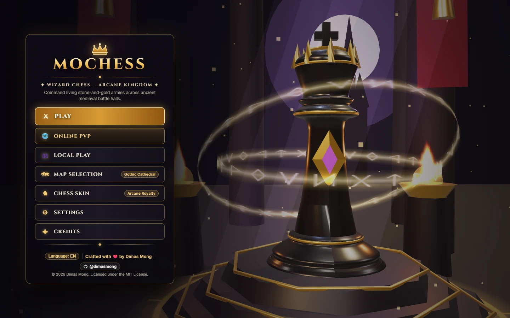 | 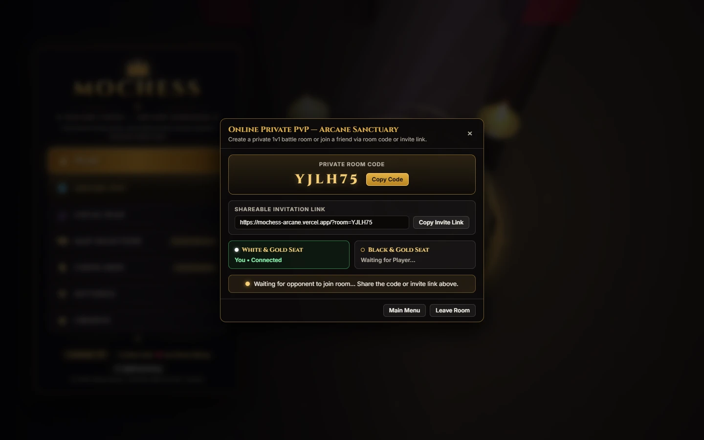 |

### Available 3D Battle Arenas
| Gothic Cathedral (`gothic-cathedral.webp`) | Royal War Hall (`royal-war-hall.webp`) |
| :---: | :---: |
| 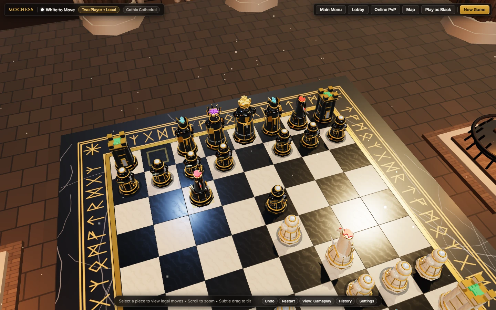 | 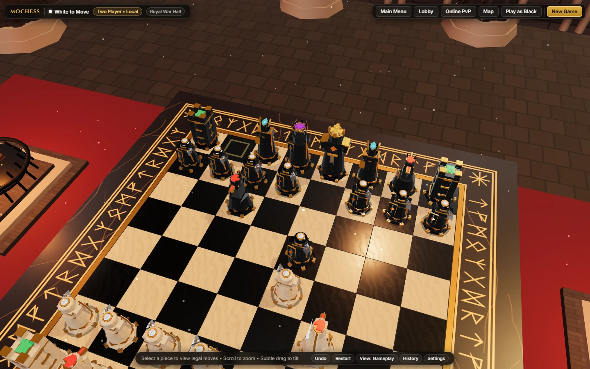 |
| **Arcane Sanctum (`arcane-sanctum.webp`)** | **Classic Board (`classic-board.webp`)** |
| 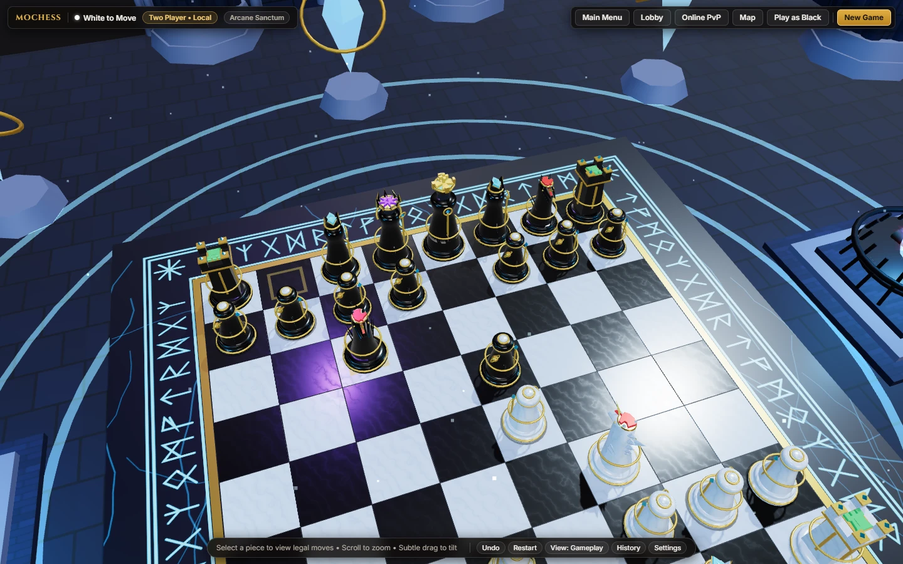 | 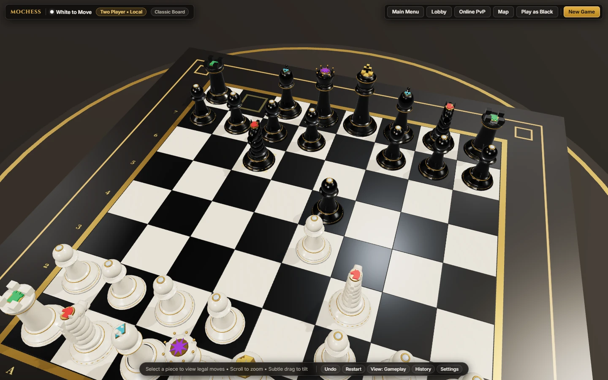 |

### Sculpted 3D Chess Piece Skins
| Arcane Royalty (`arcane-royalty.webp`) | Runic Warforged (`runic-warforged.webp`) |
| :---: | :---: |
| 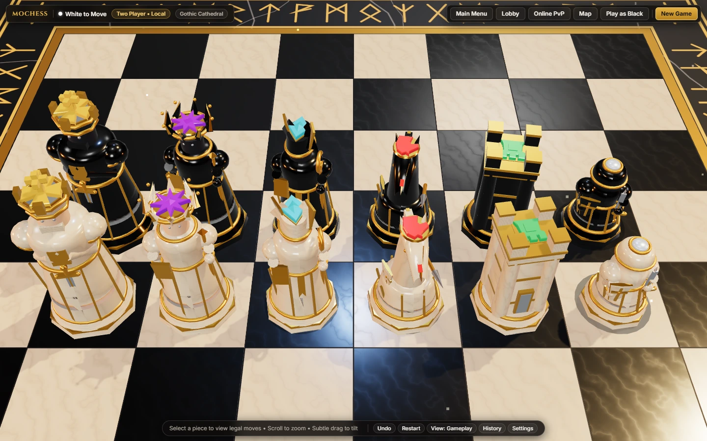 | 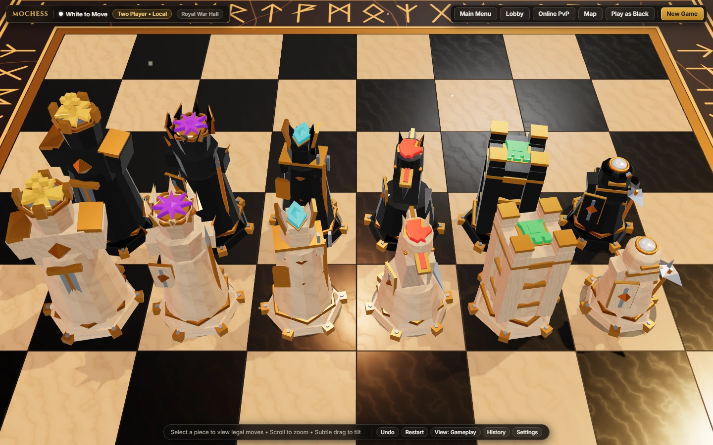 |
| **Mystic Sanctum (`mystic-sanctum-skin.webp`)** | **Classic Staunton (`classic-staunton.webp`)** |
| 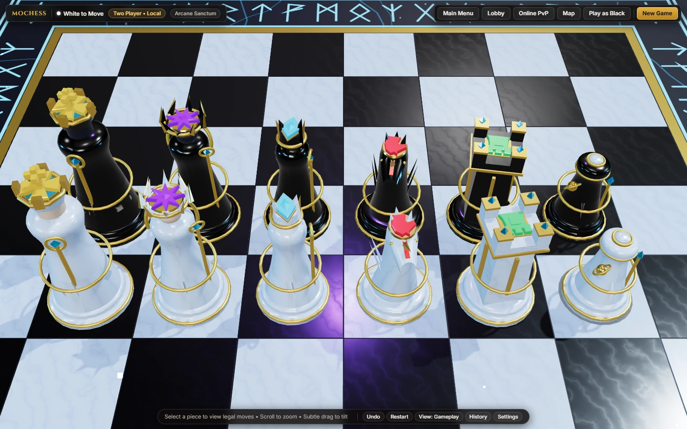 | 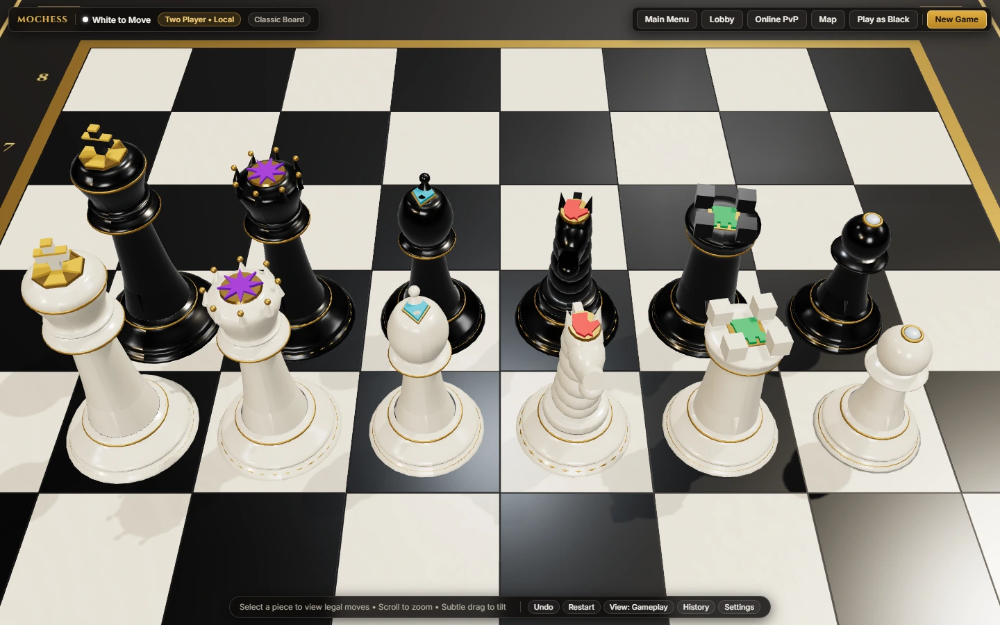 |

### Overhead Readability, Checkmate Finisher & Mobile Gameplay
| Direct Overhead Role Readability (`top-down-gameplay.webp`) | Checkmate Finisher Cutscene (`checkmate.webp`) |
| :---: | :---: |
| 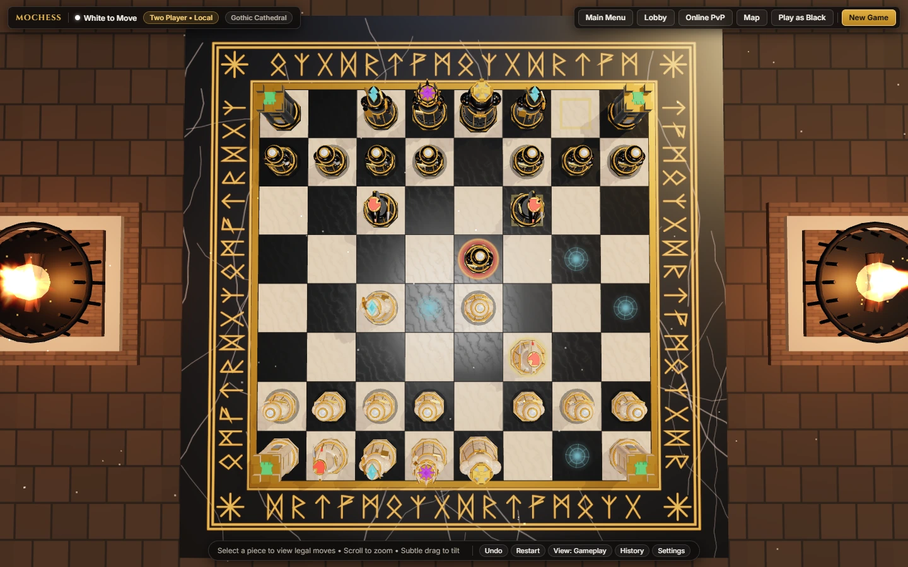 | 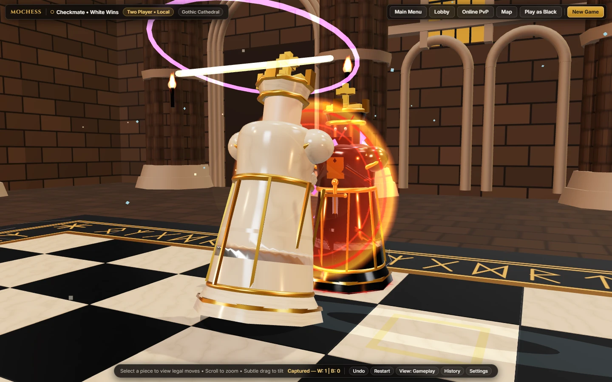 |

<div align="center">

**Responsive Android Mobile Portrait Gameplay (`mobile-gameplay.webp`)**

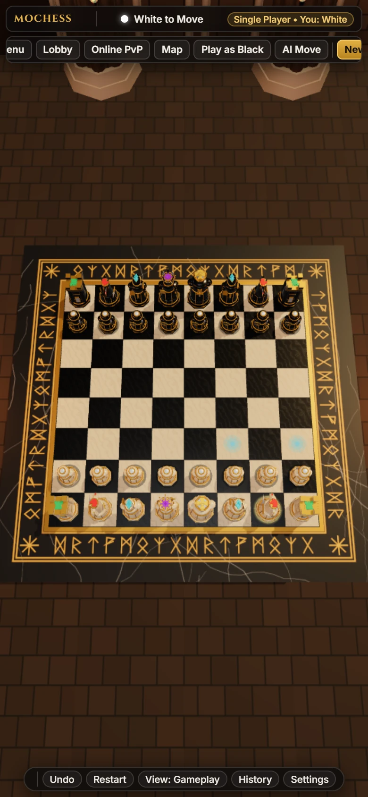

</div>

---

## 🏰 Available Arenas

| Arena | Visual Architecture & Atmosphere | Musical Score |
| :--- | :--- | :--- |
| **1. Gothic Cathedral** | Weathered dark limestone ashlar masonry, clustered fluted Gothic columns, stained-glass lancets, roaring wrought-iron fire braziers, and an obsidian-ivory runic board. | *Sacred Arcana* |
| **2. Royal War Hall** | Fortified iron-granite bastion draped in crimson-and-gold royal banners, mounted war shields, warm hearth firelight, and a champagne-travertine & bronze war-table board. | *Crown of the Kingdom* |
| **3. Arcane Sanctum** | Deep astral-indigo chamber encircled by 8 levitating mana crystal monoliths with orbiting golden astrolabe rings, glowing ley-line runes, and cyan-violet arcane flames. | *Celestial Enchantment* |
| **4. Classic Board** | Distraction-free championship study featuring a warm walnut & satin maple tournament chessboard, mahogany gallery framing, and balanced studio lighting. | *Timeless Strategy* |

---

## ♟️ Chess Skins & Overhead Role Identification

### Four Selectable 3D Chess Skins
1. **Arcane Royalty (`arcane_royalty`)** — Cathedral ivory & obsidian sovereign sculptures adorned with burnished gold crowns, shields, crosiers, and broadswords.
2. **Runic Warforged (`runic_warforged`)** — Heavy hexagonal gear-pedestal battle constructs forged in plated armor, horned helms, and angular siege battlements.
3. **Mystic Sanctum (`mystic_sanctum`)** — Tapered celestial alabaster & void-obsidian monoliths encircled by levitating golden astrolabe rings and floating mana crystals.
4. **Classic Staunton (`classic`)** — Authentic championship turned-wood Staunton silhouettes with subtle, non-glowing satin tournament enamel inlays.

### Universal 3-Layer Overhead Role System
Every chess role across all four skins combines a **unique overhead silhouette**, an **extruded 3D upper emblem** (never flat browser emoji overlays), and a **controlled upper accent color** while keeping White and Black faction body colors dominant:

| Chess Role | Role Accent Color | 3D Top Symbol | Sculpted Overhead Silhouette & Combat Attack |
| :--- | :--- | :---: | :--- |
| **King (`k`)** | Royal Gold (`#f6c138`) | `✠` Crown Cross | Largest octagonal 4-bastion sovereign crown + vertical cross finial • *Two-handed royal greatsword cleave* |
| **Queen (`q`)** | Amethyst Purple (`#9b3dff`) | `✴` 8-Point Star | Wide flared 8-point radial starburst coronet • *Celestial sky-pillar beam & star-nova burst* |
| **Bishop (`b`)** | Arcane Cyan (`#14ccf5`) | `◆` Sacred Diamond | Pointed ceremonial mitre with diagonal cleft cut • *Spiraled crosier arcane beam & rune sigil* |
| **Knight (`n`)** | Ember Red (`#eb3434`) | `♞` Horse Crest | Asymmetric forward-projecting warhorse snout & arched mane • *Vaulting L-jump & couched lance shockwave* |
| **Rook (`r`)** | Emerald Green (`#18c668`) | `♜` Fortress Keep | Bold square `90°` 4-merlon castellated fortress deck • *Rising siege slam & double seismic rings* |
| **Pawn (`p`)** | Pearl Silver (`#c6daf0`) | `●` Single Medallion | Smallest compact circular collar & smooth rounded cap • *Diagonal vanguard sword slash* |

> **Accessibility Toggle**: Players can toggle **Piece Identification Markers (`ON / OFF`)** at any time in **Settings** (`localStorage` persisted, independent of Low/Medium/High graphics quality).

---

## 🎮 Controls & Game Modes

### Controls (Desktop & Android Mobile)
| Action | Desktop (Mouse) | Android / Mobile (Touch) |
| :--- | :--- | :--- |
| **Select Piece / Move** | Left-click friendly piece, then click highlighted destination square | Tap friendly piece, then tap highlighted destination square |
| **Zoom In / Out** | Mouse scroll wheel (clamped to safe board bounds) | Two-finger pinch gesture |
| **Subtle Camera Tilt / Orbit** | Left-click + drag (`> 6px` drag never triggers accidental moves) | Single-finger swipe |
| **Switch Camera Preset** | Click `View: Gameplay / Overhead / 3/4` in bottom HUD bar | Tap `View` button in bottom HUD bar |
| **Skip Intro Cinematic** | Click `Skip Intro` or click the board during opening sweep | Tap `Skip Intro` or tap the board |

### Game Modes
- **Single Player vs AI**: Choose `White & Gold` or `Black & Gold` against `Novice`, `Knight`, `Archmage`, or `Grandmaster` AI, with `Unlimited`, `3m Blitz`, `5m Blitz`, or `10m Rapid` clocks.
- **Local Play (2 Players)**: Pass-and-play Human vs Human on one screen.
- **Online Private PvP (1v1)**: Host a private room (`Create Private Room`), share the 6-character room code or invite link (`?room=XXXXXX`), and battle across Desktop and Android browsers with server-validated moves and rematch support.

---

## 🛠️ Technology Stack

- **3D Engine**: [Three.js](https://threejs.org/) (`r170` — `WebGLRenderer`, `GLTFLoader`, `GLTFExporter`, `LOD`, `OrbitControls`, `PMREMGenerator`)
- **Language & Bundler**: [TypeScript 5.6](https://www.typescriptlang.org/) + [Vite 5](https://vitejs.dev/)
- **Chess Rules Engine**: [chess.js](https://github.com/jhlywa/chess.js) (`v1.0.0-beta.8`)
- **AI Engine**: Dedicated Web Worker (`src/ai/chessAI.worker.ts`) running Negamax + Alpha-Beta pruning + Quiescence search + MVV-LVA
- **3D Asset & Audio Pipelines**:
  - Sculpted glTF 2.0 `.glb` generator (`scripts/generate_glb_assets.mjs` + `src/assets/PieceGeometryBuilder.ts`) & optional headless Blender Python generator (`scripts/blender/generate_pieces.py`)
  - Multi-instrument WAV soundtrack synthesizer (`scripts/generate_magical_music_assets.mjs`) & Web Audio API mixer (`src/audio/SoundManager.ts`)
- **Online PvP Backend**: Vercel Serverless Function (`api/rooms.ts` + `src/server/onlineRoomService.ts`) with atomic Compare-And-Swap (`CAS`) state updates on Upstash Redis / Vercel KV (plus automatic in-memory fallback for zero-config local dev)
- **Automated QA**: [Vitest](https://vitest.dev/) (`35` unit/engine/AI/hitbox/asset tests) + [Playwright](https://playwright.dev/) E2E WebGL verification

---

## 🚀 Installation & Local Development

### Prerequisites
- **Node.js** `>= 18.0.0` and **npm** `>= 9.0.0`
- *(Optional)* **Blender** `>= 3.6` only if running `scripts/blender/generate_pieces.py` directly

### 1. Clone & Install
```bash
git clone https://github.com/dimasmong/MoChess.git
cd MoChess
npm install
```

### 2. Start Local Development Server
```bash
npm run dev
```
Open `http://localhost:5173` in Chrome, Edge, Firefox, or Android Chrome (includes the local `/api/rooms` Online PvP middleware out of the box).

### 3. Run Automated Tests
```bash
npm test
```

### 4. Production Build & Preview
```bash
npm run build
npm run preview
```
`npm run build` generates the binary `.glb` piece models (`public/models/*.glb`), runs strict TypeScript type-checking (`tsc`), and bundles the optimized production output into `dist/`.

---

## ☁️ Deployment

### Vercel (Full Frontend + Online PvP Serverless API)
MoChess deploys out of the box to **Vercel** (`vercel.json` included):
1. Import `dimasmong/MoChess` into Vercel (Framework Preset: **Vite**, Build Command: `npm run build`, Output Directory: `dist`).
2. *(Recommended for multi-instance Online PvP persistence)* Connect a free **Upstash Redis / Vercel KV** store (`UPSTASH_REDIS_REST_URL` & `UPSTASH_REDIS_REST_TOKEN` or `REDIS_URL`).
3. Live Production Deployment: **[https://mochess-arcane.vercel.app](https://mochess-arcane.vercel.app)**

### Standalone Release ZIP (`dist/`)
Each GitHub Release provides a pre-built static package (`MoChess-vX.Y.Z-web.zip`):
- Extract and serve over any static HTTP server (e.g. `npx serve .` or `python -m http.server 8080`) to play **Single Player vs AI** and **Local 2-Player** offline/self-hosted.
- *Note*: **Online Private PvP** requires the `/api/rooms` serverless endpoint (included when running `npm run dev` / `npm run preview` or deployed on Vercel) and is not included inside a purely static file server.

---

## 📂 Project Structure

```text
MoChess/
├── api/
│   └── rooms.ts                              # Vercel Serverless endpoint for Online Private PvP
├── docs/
│   └── screenshots/                          # 13 genuine in-game WebP screenshots
├── public/
│   ├── audio/music/                          # 5 original looping magical fantasy WAV scores
│   ├── models/                               # Exported glTF 2.0 3D chess models (*.glb)
│   └── previews/                             # Real WebGL 3D arena & 12-piece skin previews
├── scripts/
│   ├── blender/generate_pieces.py            # Optional headless Blender Python 3D generator
│   ├── capture_release_screenshots.mjs       # Playwright genuine WebP screenshot generator
│   ├── generate_3d_previews.mjs              # WebGL 3D arena & skin preview renderer
│   ├── generate_glb_assets.mjs               # Node + Three.js GLB exporter & validator
│   ├── generate_magical_music_assets.mjs     # Original fantasy soundtrack synthesizer
│   └── verify_v7_overhead_readability.mjs    # Playwright E2E gameplay & readability suite
├── src/
│   ├── ai/                                   # AIManager & non-blocking Alpha-Beta Web Worker
│   ├── assets/                               # PieceGeometryBuilder, PieceAssetManager, PBR textures
│   ├── audio/                                # SoundManager (crossfading music & battle SFX)
│   ├── engine/                               # Authoritative ChessGameEngine & TypeScript types
│   ├── online/                               # OnlineMultiplayerClient (polling, tokens, rematch)
│   ├── scene/                                # SceneManager, MenuHeroScene, Arena, Board, Animations
│   ├── server/                               # Authoritative onlineRoomService & Redis CAS store
│   ├── styles/                               # Responsive dark-fantasy UI stylesheet
│   ├── ui/                                   # UIManager & bilingual EN/ID dictionary (i18n.ts)
│   └── main.ts                               # Application entry point
├── tests/                                    # Vitest unit, AI, hitbox, online & 3D asset suites
├── index.html
├── LICENSE                                   # MIT License
├── THIRD_PARTY_NOTICES.md                    # Open-source library & font attributions
├── package.json
├── tsconfig.json
├── vercel.json
└── vite.config.ts
```

---

## 📜 Credits & Open-Source Attribution

### Developer
- **Creator & Lead Developer**: **Dimas Mong**
  - GitHub: [https://github.com/dimasmong](https://github.com/dimasmong)
  - Live Game: [https://mochess-arcane.vercel.app](https://mochess-arcane.vercel.app)

### Open-Source Attribution
MoChess uses original code, procedurally sculpted 3D assets, and synthesized music alongside open-source libraries:
- **[Three.js](https://threejs.org/)** — MIT License
- **[chess.js](https://github.com/jhlywa/chess.js)** — BSD-2-Clause License
- **[TypeScript](https://www.typescriptlang.org/)** — Apache-2.0 License
- **[Vite](https://vitejs.dev/)** & **[Vitest](https://vitest.dev/)** — MIT License
- **[Playwright](https://playwright.dev/)** — Apache-2.0 License
- **[Cinzel](https://fonts.google.com/specimen/Cinzel)** & **[Inter](https://fonts.google.com/specimen/Inter)** Fonts — SIL Open Font License 1.1

See [THIRD_PARTY_NOTICES.md](./THIRD_PARTY_NOTICES.md) for full attribution details.

---

## ⚖️ License

This project is licensed under the **MIT License** — see the [LICENSE](./LICENSE) file for full license text.

<div align="center">

**Crafted by [Dimas Mong](https://github.com/dimasmong)**  
*© 2026 Dimas Mong • MoChess: Wizard Chess — Arcane Kingdom*

</div>
